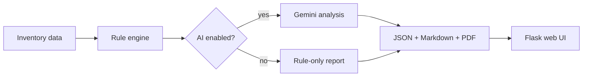

# IAM Auditor

<div align="center">
  
  
  
  
</div>

A modern IAM access review platform for Microsoft Entra ID and Azure RBAC. It blends deterministic detection rules with optional AI-powered analysis to surface risky privileges, stale access, and identity hygiene issues before they become security incidents.

> Built for security teams, auditors, and IAM engineers who need evidence-based findings and clear remediation guidance.

## Why this project stands out

- Deterministic rule engine for fast, explainable findings
- Optional Gemini-backed risk narrative and executive summary
- PDF, Markdown, and JSON output for audit workflows
- Minimal web UI to run scans and inspect job logs without the CLI
- Support for demo data and real tenant inventories

## Feature highlights

| Capability | Value |
| --- | --- |
| Privileged access review | Detects risky role assignments outside allowed departments |
| MFA and inactivity checks | Flags privileged accounts without MFA and dormant access |
| HR leaver validation | Identifies users still active after departure |
| AI augmentation | Adds context-aware summaries and remediation advice |
| Reporting | Exports polished audit artifacts for stakeholders |

## Quick start

### 1) Setup the environment

```bash
python -m venv .venv
# Windows PowerShell
.\.venv\Scripts\Activate.ps1
# macOS/Linux
# source .venv/bin/activate

pip install -r requirements.txt
```

### 2) Configure your secrets

```bash
copy .env.example .env
```

Then set the values you need:

- `GEMINI_API_KEY` — optional, required only for AI mode
- `GEMINI_MODEL` — optional, defaults to `gemini-2.5-flash`
- `AZURE_TENANT_ID`, `AZURE_CLIENT_ID`, `AZURE_CLIENT_SECRET` — only for live Entra ID / Azure collection

### 3) Run the demo workflow

```bash
python src/generate_data.py
python src/audit.py --no-llm
python src/audit.py
python src/audit.py --deep
```

Generated outputs:

- `outputs/audit_result.json`
- `outputs/audit_report.md`
- `outputs/audit_report.pdf`

### 4) Launch the web UI

```bash
python app.py
```

Then open http://localhost:5000 and run an audit from the browser.

## Core workflows

### Demo mode

```bash
python src/generate_data.py
python src/audit.py --no-llm
```

### Rules + AI summary

```bash
python src/audit.py
```

### Deep review of all profiles

```bash
python src/audit.py --deep
```

### Real Entra ID and Azure RBAC collection

```bash
az login
python src/collect_entra.py
python src/audit.py --input iam_inventory_real.json
```

Optional HR feed:

- add one user principal name per line in `data/hr_leavers.txt`
- the tool treats those identities as leavers and checks whether access still remains active

## Real tenant simulation

Use the test-tenant flow only against a tenant you control.

```bash
python src/seed_tenant.py create --dry-run
python src/seed_tenant.py create
python src/collect_entra.py
python src/seed_tenant.py overlay
python src/audit.py --input iam_inventory_real.json
python src/seed_tenant.py cleanup
```

## Detection rules

| Rule | What it catches | Severity |
| --- | --- | --- |
| `EXCESSIVE_PRIVILEGE` | privileged role assigned to a user outside approved departments | Critical |
| `PRIVILEGED_NO_MFA` | privileged identity does not have MFA enabled | Critical |
| `LEAVER_STILL_ACTIVE` | former employee still retains access | Critical |
| `DORMANT_ACCOUNT` | account has long-standing access but no recent use | Medium |
| `LLM_CONTEXT_REVIEW` | role/title mismatch that a static rule cannot express | AI-rated |

These findings are mapped to ISO 27001:2022 and NIST CSF 2.0 controls for audit reporting.

## Architecture overview



## Repository structure

```text
iam-auditor/
├── app.py                     # Flask dashboard for audit jobs
├── src/
│   ├── audit.py               # main CLI orchestration
│   ├── collect_entra.py       # Entra ID + Azure RBAC inventory collection
│   ├── config.py              # env and path configuration
│   ├── generate_data.py       # synthetic inventory and anomaly generation
│   ├── llm_client.py          # Gemini integration and JSON parsing
│   ├── report_pdf.py          # PDF export logic
│   ├── rules.py               # IAM detection logic
│   └── seed_tenant.py         # test-tenant provisioning and cleanup
├── data/
│   ├── iam_inventory.json
│   ├── iam_inventory_real.json
│   ├── hr_leavers.txt
│   └── seed_state.json
├── outputs/
├── logs/
├── templates/
├── static/
├── tests/
│   ├── test_rules.py
│   └── test_scenarios.py
├── docs/
│   ├── ARCHITECTURE.md
│   ├── AZURE_SETUP.md
│   └── STEP_BY_STEP.md
├── .env.example
├── Dockerfile
├── docker-compose.yml
├── Makefile
├── requirements.txt
├── README.md
└── llm-models.py
```

## AI and privacy notes

- Direct identifiers are minimized before LLM analysis
- AI is used for contextual interpretation, not as the sole source of truth
- `--no-llm` still provides a solid rules-only audit path

## Testing

```bash
pytest -q tests
```

## Documentation

- `docs/ARCHITECTURE.md` — system design and flow
- `docs/AZURE_SETUP.md` — Azure auth and cloud setup
- `docs/STEP_BY_STEP.md` — guided operational walkthrough

## License

This project is intended for internal security auditing, governance review, and learning. Use it only in environments you are authorized to assess.
