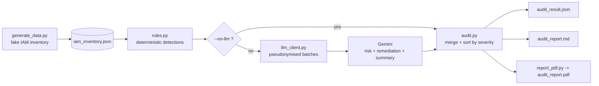
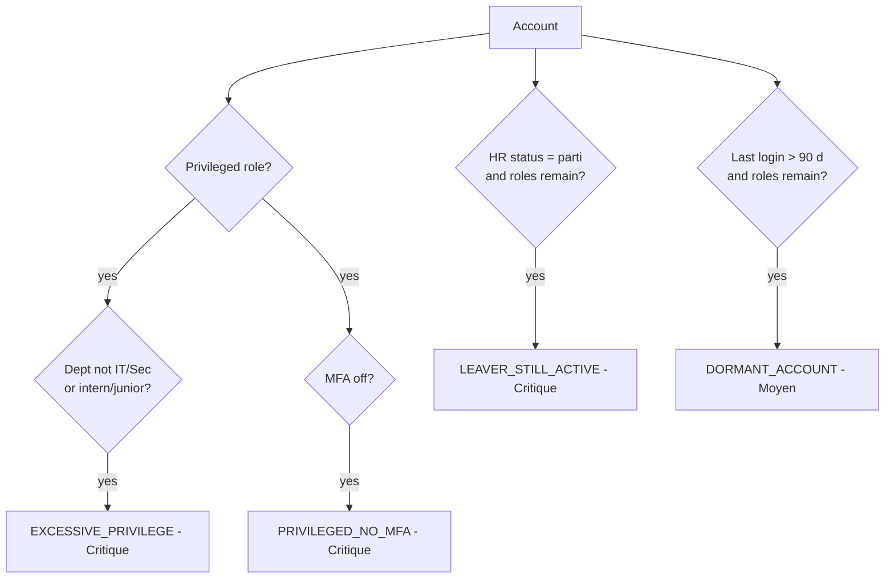
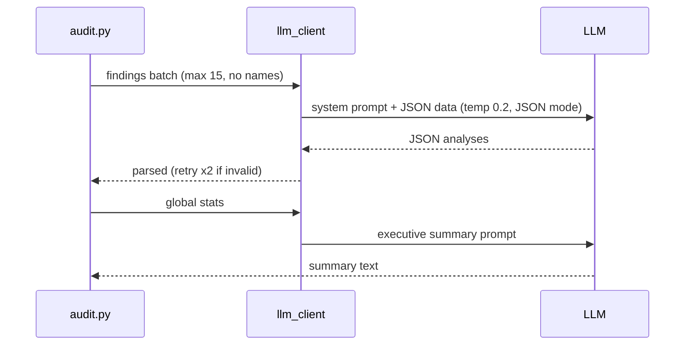
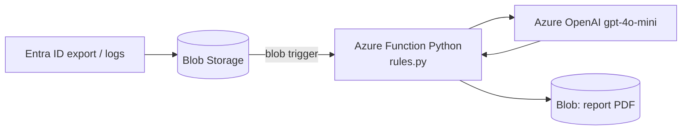

# Architecture & workflows

## 1. Global pipeline

## 2. Per-account decision flow

## 3. LLM interaction

## 4. Azure target architecture

## 5. Data model (iam_inventory.json)
id, nom, poste, departement, roles_azure[], mfa_active, type_compte (humain|service), statut_rh (actif|parti), derniere_connexion (ISO date)
